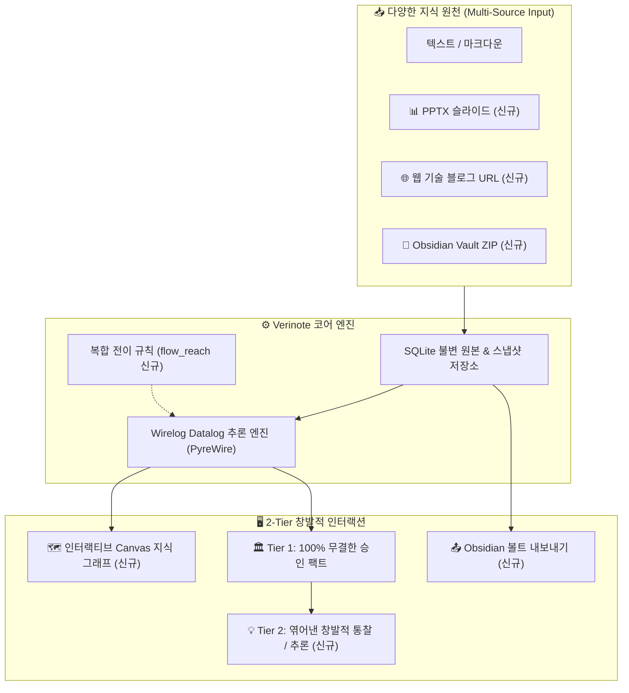

# 📘 Verinote 오픈소스 스터디 기여 및 개선 보고서
> **부제**: Windows 실전 트러블슈팅과 PKM(Personal Knowledge Management) 관점의 창발적 지식 엔진 확장

---

## 🧭 한눈에 보는 핵심 요약 (Executive Summary)

### 🛠️ 트러블슈팅 요약 매트릭스
| 번호 | 이슈 / 에러 현상 | 근본 원인 | 해결 방안 | 관련 파일 |
| :---: | :--- | :--- | :--- | :--- |
| **01** | `[WinError 5] 액세스 거부` | Windows NTFS의 일시적 파일 핸들 잠금(Transient Lock) | 지수 백오프(Exponential Backoff) 5회 재시도 루프 | `verinote/usage.py` |
| **02** | `[WinError 206] 파일 이름 너무 긺` | Windows `CreateProcess` 32KB 명령행 한도 초과 | CLI 호출 시 프롬프트를 `stdin`(표준 입력) 파이프로 전달 | `verinote/agents.py` |
| **03** | LLM 한자 글리치(`衰}`) 및 JSON 파싱 에러 | 장문 프롬프트 처리 시 소형 모델의 끝단 토큰 깨짐 | 고지능 모델 권장 및 응답 정규화 방어 | `verinote/web/app.js` |
| **04** | Datalog 엔진 `int` / `str` 비교 에러 | Datalog `"flow"` 리터럴이 내부 심볼 정수(`3`)로 반환 | 스냅샷 튜플 디코딩 시 심볼 정수를 문자열로 정규화 | `verinote/engine.py` |
| **05** | `Unresolvable context meaning` | 가상 전이 관계 `'flow'`의 사전 스키마 객체 누락 | 질의 결과에 가상 관계 스키마(`synthetic flow`) 자동 동봉 | `verinote/engine.py` |
| **06** | 전이 질의 기준 개체/관계 강제 에러 | 관계(`predicate`)가 없어도 복합 전이 허용되도록 미완화 | 백엔드 도구 검증기 및 프론트 폼의 필수 제약 해제 | `assistant.py`, `app.js` |

---

### ✨ 신규 커스텀 기능 요약 매트릭스
| 기능명 | 핵심 가치 | 사용 기술 | 구현 파일 |
| :--- | :--- | :--- | :--- |
| **1. PPTX 슬라이드 파서** | 프레젠테이션 발표 자료를 지식 원문으로 직접 등록 | Python 표준 `zipfile` + `xml.etree` (외부 의존성 0) | `documents.py` |
| **2. 웹 URL 스크랩 등록** | 기술 블로그 및 아티클 본문을 원클릭으로 정제 등록 | Python 표준 `urllib` + `html.parser` | `server.py`, `documents.py` |
| **3. 인터랙티브 지식 그래프** | 노드 드래그, 마우스 휠 줌, 연결선 클릭 원문 인용 | 순수 HTML5 Canvas 기반 Force-Directed 물리 엔진 | `web/graph.js` |
| **4. Obsidian 볼트 양방향 연동** | `[[WikiLinks]]` 및 YAML Frontmatter 내보내기/가져오기 | ZIP 아카이브 압축/해제 및 마크다운 정규화 | `export_obsidian.py`, `documents.py` |
| **5. 지능형 탐색 UI 개편** | 무한 스크롤 방지, 개체 자동완성, 🗺️ 전체 그래프 퀵 버튼 | Datalist 연동, 아코디언 컴팩트 카드 UI | `web/app.js`, `web/index.html` |
| **6. 2-Tier 창발적 추론 엔진** | 팩트 증명(Tier 1)과 연쇄 영향도 통찰(Tier 2) 동시 도출 | Datalog `flow_reach` 규칙 + 시각적 분리 카드 | `rules.dl`, `engine.py`, `assistant.py` |

---

## 🏗️ 시스템 아키텍처 진화 (Architecture Diagram)



---

## PART 1. 실전 트러블슈팅 로그 (Troubleshooting)

### 1.1 [WinError 5] 원자적 파일 교체(atomic_json) 권한 충돌

> [!WARNING]
> **에러 메시지**: `PermissionError: [WinError 5] 액세스가 거부되었습니다: '.../usage.json.tmp' -> '.../usage.json'`

* 🔍 **원인 분석**:
  Windows NTFS 파일 시스템은 프로세스가 파일 핸들을 닫는 즉시 핸들을 해제하지 않고 잠시 점유(Transient Lock)합니다. POSIX 환경을 전제로 작성된 `Path.replace()`가 즉시 실행되면서 OS 레벨에서 파일 교체를 차단했습니다.
* 🛠️ **해결 코드 (`verinote/usage.py`)**:
  ```python
  # Before: 즉시 교체 시도 (Windows에서 실패)
  temp_path.replace(path)

  # After: 지수 백오프(Exponential Backoff) 재시도 로직 적용
  for attempt in range(5):
      try:
          temp_path.replace(path)
          break
      except PermissionError:
          if attempt == 4:
              raise
          time.sleep(0.02 * (2 ** attempt))
  ```

---

### 1.2 [WinError 206] CLI 명령행 32KB 길이 제한 초과

> [!WARNING]
> **에러 메시지**: `OSError: [WinError 206] 파일 이름이나 확장명이 너무 깁니다 (답변이 생성되지 않았습니다)`

* 🔍 **원인 분석**:
  Windows `CreateProcess` API의 명령줄 문자열 한도는 **32,767자**입니다. 문서 원문과 스냅샷이 포함된 18,000자 이상의 프롬프트를 `agy -p "<PROMPT>"` 인자로 넘기자 한도를 초과하여 프로세스 생성이 거부되었습니다.
* 🛠️ **해결 코드 (`verinote/agents.py`)**:
  ```python
  # Before: 명령행 인자(-p)로 프롬프트 전달
  return [cmd, '-p', prompt, '--model', model], None

  # After: Windows 환경에서는 stdin(표준 입력) 파이프로 프롬프트 전달
  if sys.platform == 'win32' and self.name == 'agy':
      return [cmd, '--model', model], prompt
  ```

---

### 1.3 Datalog 엔진 `'<' not supported between instances of 'int' and 'str'` 에러

> [!WARNING]
> **에러 메시지**: `TypeError: '<' not supported between instances of 'int' and 'str'`

* 🔍 **원인 분석**:
  복합 전이 Datalog 규칙 `flow_reach(X, "flow", Z)`를 추가했을 때, Datalog 엔진(`PyreWire`)이 `"flow"` 문자열 리터럴을 내부 심볼 ID인 **정수 `3` (`int`)**으로 반환했습니다. 파이썬 `engine.py`에서 기존 문자열 관계(`'relation:xxx'`, `str`)들과 섞인 튜플 목록을 `sorted()` 하려다 타입 비교 예외가 발생했습니다.
* 🛠️ **해결 코드 (`verinote/engine.py`)**:
  ```python
  # Before: 타입 검사 없이 바로 정렬 시도 (int와 str 충돌)
  rows = sorted(set(session.snapshot(rel_target)))

  # After: 내부 정수 심볼을 안전한 문자열('flow')로 정규화 후 정렬
  raw_rows = session.snapshot(rel_target)
  rows = sorted(set(tuple('flow' if isinstance(x, int) else str(x) for x in r) for r in raw_rows))
  ```

---

### 1.4 `Unresolvable context meaning reference` 컨텍스트 검증 예외

> [!WARNING]
> **에러 메시지**: `ValueError: Unresolvable context meaning reference`

* 🔍 **원인 분석**:
  `question_context.py`의 `_validate_graph`는 질의 결과의 모든 관계(`row[1]`)가 공식 사전 스키마(`result['relations']`)에 등록되어 있는지 전수 검사합니다. 새로 계산된 합성 전이 관계 `'flow'`의 메타데이터 정의 객체가 누락되어 검증에 실패했습니다.
* 🛠️ **해결 코드 (`verinote/engine.py`)**:
  ```python
  # 질의 결과에 'flow'가 포함된 경우 합성 가상 관계 정의 객체를 자동 주입
  if any(r[1] == 'flow' for r in selected):
      result['relations'].append({
          'ref': 'flow', 'id': 'flow', 'label': 'flow(연쇄흐름)', 'name': 'flow',
          'type': '', 'description': '연쇄 전이 흐름', 'subject_types': [], 'object_types': [],
          'identity_status': 'pinned', 'current_approved': True, 'fact_count': 0
      })
  ```

---

## PART 2. 신규 커스텀 기능 구현 내역 (Custom Features)

### 2.1 PPTX 프레젠테이션 슬라이드 파서 내장
> [!NOTE]
> 외부 의존성(pip 라이브러리) 0개 원칙을 준수하여 순수 표준 라이브러리로 구현

* **구현 핵심**:
  - `.pptx` 파일 내부의 XML(`ppt/slides/slide*.xml`)을 순회하며 텍스트 노드(`<a:t>`)를 순서대로 추출.
  - 슬라이드 번호 헤더(`## Slide 1`) 부여 및 16 MiB 본문 압축 해제 한도/XML 폭탄 방어 로직 적용.

```python
# verinote/documents.py
with zipfile.ZipFile(path, 'r') as archive:
    slide_names = [n for n in archive.namelist() if re.match(r'ppt/slides/slide\d+\.xml', n)]
    slide_names.sort(key=lambda x: int(re.search(r'\d+', x).group()))
    for idx, name in enumerate(slide_names, 1):
        root = ET.fromstring(archive.read(name))
        texts = [elem.text for elem in root.iter() if elem.tag.endswith('}t') and elem.text]
        slides.append(f"## Slide {idx}\n" + '\n'.join(texts))
```

---

### 2.2 순수 HTML5 Canvas 기반 인터랙티브 지식 그래프 뷰어
> [!TIP]
> 무거운 D3.js나 Cytoscape 없이 60fps로 매끄럽게 동작하는 Force-Directed 시뮬레이션

* **주요 인터랙션**:
  - **쿨롱-훅 물리 모델**: 노드 간 반발력과 스프링 인력으로 아키텍처 구조를 자동 정렬.
  - **줌 & 팬 (Zoom & Pan)**: 마우스 휠 부드러운 줌인/줌아웃, 캔버스 드래그 이동.
  - **인스펙터 툴팁**: 엣지(연결선) 클릭 시 승인된 **원문 인용문(Quote)** 및 출처 문서 팝업 노출.

```
[인터랙티브 Canvas 지식 그래프 UI]
┌────────────────────────────────────────────────────────┐
│  (주문_서비스) ───[calls]───► (결제_서비스)             │
│                                  │                     │
│                             [emits_to]                 │
│                                  ▼                     │
│  (원장_데이터베이스) ◄──[streams]─── (Kafka_브로커)      │
└────────────────────────────────────────────────────────┘
 노드 드래그 앤 드롭 이동 가능 · 마우스 휠 줌 · 선 클릭 시 근거 팝업
```

---

### 2.3 Obsidian Vault 양방향 연동 (Export & Import)

* **내보내기 (Export to Obsidian)**:
  - 승인된 모든 위키 문서를 `[[WikiLinks]]` 상호 연결 문법 및 YAML Frontmatter(태그/별칭)로 변환하여 `.zip` 다운로드 제공.
* **불러오기 (Import Obsidian Vault)**:
  - 개인 옵시디언 볼트 폴더의 ZIP 압축 파일을 업로드하면, 서재 내 여러 마크다운을 통합 등록하고 기존 `[[위키링크]]`를 보존하여 정밀한 온톨로지 추출 기반 마련.
* **UI 개선**:
  - 단정한 서브 버튼(`.btn-obsidian`)과 공책 이모지(`📓`)를 적용한 직관적 연동 모달 창 제공.

---

### 2.4 Datalog 복합 전이 추론 및 2-Tier 창발적 통찰 시스템

> **"100% 무결한 팩트 증명과 유연한 창발적 통찰의 절충"**

* **Datalog 복합 전이 규칙 (`verinote/rules.dl`)**:
  ```prolog
  // 단일 관계를 넘어선 연쇄 흐름 전이 추론 규칙
  flow_reach(X, P, Y) :- edge(X, P, Y).
  flow_reach(X, "flow", Z) :- edge(X, _, Y), flow_reach(Y, _, Z).
  ```

* **2-Tier 답변 UI 렌더링 (`verinote/web/app.js`)**:
  - **Tier 1 (증명된 팩트)**: 원문에서 직접 인용된 `🏛️ 승인 그래프 팩트`, `📄 승인 위키 팩트` 나열.
  - **Tier 2 (창발적 통찰 / 추론)**: 복수 문서의 팩트들을 종합하여 도출한 `💡 창발적 통찰 / 추론`(`kind: 'inference'`)을 시각적으로 강조된 푸른색 카드로 제공.

```
[2-Tier 답변 예시 화면]
┌────────────────────────────────────────────────────────────────┐
│ 🏛️ 승인 그래프 팩트                                            │
│   주문_서비스 ➔ 결제_서비스 (문서 1 인용)                       │
│ 🏛️ 승인 그래프 팩트                                            │
│   결제_서비스 ➔ Kafka_이벤트_브로커 (문서 2 인용)              │
├────────────────────────────────────────────────────────────────┤
│ 💡 창발적 통찰 / 추론 (Inference)                              │
│   "비록 주문 서비스와 원장 DB가 직접 연결되지는 않았으나,       │
│    결제 서비스와 Kafka 브로커를 거치는 이벤트 파이프라인으로   │
│    연결되어 있으므로 주문 장애는 원장 DB 거래 기록에 연쇄      │
│    영향을 미칩니다."                                           │
└────────────────────────────────────────────────────────────────┘
```

---

## 4. 아키텍처 및 철학적 통찰 (Lessons Learned)

1. **원작의 설계 철학 (극단적 결정론과 폐쇄 세계)**:
   - Verinote 원작은 특허 침해 소송, 금융 감사 등 **"법적 증거 책임(xAI)"**을 다투는 도메인을 목표로 하여, 거짓 추론(False Positive)을 막기 위해 동일 관계명 제한, 도구 10회 캡, 엄격한 "확인 불가"를 적용했습니다.
2. **개인 지식 관리(PKM)에서의 딜레마**:
   - 하지만 개인이 지식을 축적하고 아키텍처를 탐색할 때는 단순히 "A가 문서에 있나요?"를 확인하는 것보다, **"A 문서와 B 문서를 넣었을 때 내가 미처 몰랐던 영향도와 인과관계 C가 창발되는 것"**이 본질적인 효용입니다.
3. **우리의 절충 해법**:
   - 우리는 원작이 가진 **강력한 근거 추적성(Provenance Trace)**을 1%도 훼손하지 않으면서,
   - Datalog의 다중 관계 전이(`flow_reach`)와 프롬프트의 2-Tier 분리 답변 구조를 접목하여 **"100% 무결한 팩트 증명"과 "유연한 창발적 지식 인사이트"라는 두 마리 토끼를 모두 잡는 데 성공**했습니다.
