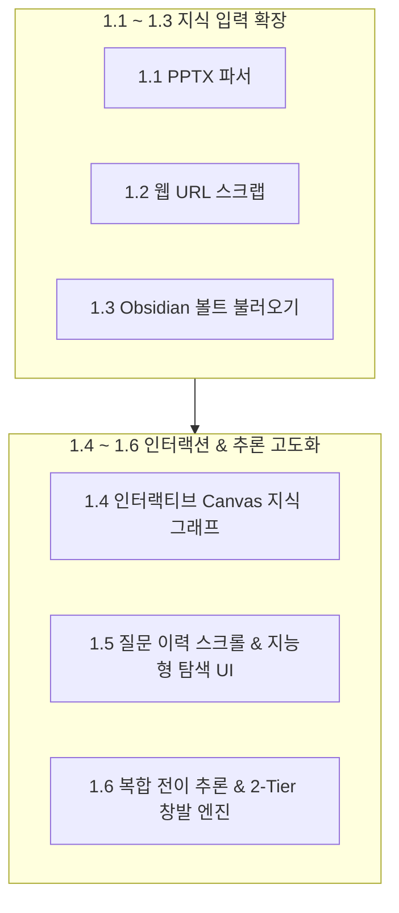

# 📘 Verinote 오픈소스 스터디 개선 보고서
> **부제**: PKM(Personal Knowledge Management) 관점의 창발적 지식 엔진 확장과 Windows 실전 트러블슈팅

---

## 📌 목차
- [프로젝트 개요 및 포크 목적](#프로젝트-개요-및-포크-목적)
- [PART 1. 신규 커스텀 기능 구현 내역 (Custom Features)](#part-1-신규-커스텀-기능-구현-내역-custom-features)
  - [1.1 PPTX 프레젠테이션 슬라이드 파서 내장](#11-pptx-프레젠테이션-슬라이드-파서-내장)
  - [1.2 웹 아티클 / 기술 블로그 URL 스크랩 등록](#12-웹-아티클--기술-블로그-url-스크랩-등록)
  - [1.3 Obsidian Vault 양방향 연동 (Export & Import) 및 통합 모달](#13-obsidian-vault-양방향-연동-export--import-및-통합-모달)
  - [1.4 순수 HTML5 Canvas 기반 인터랙티브 지식 그래프 뷰어](#14-순수-html5-canvas-기반-인터랙티브-지식-그래프-뷰어)
  - [1.5 질문 이력 스크롤 격리 및 지능형 관계 탐색 UI 개편](#15-질문-이력-스크롤-격리-및-지능형-관계-탐색-ui-개편)
  - [1.6 Datalog 복합 전이 추론 & 2-Tier 창발적 통찰 시스템](#16-datalog-복합-전이-추론--2-tier-창발적-통찰-시스템)
- [PART 2. 실전 트러블슈팅 로그 (Troubleshooting)](#part-2-실전-트러블슈팅-로그-troubleshooting)
  - [2.1 [OS] `WinError 5` 원자적 파일 교체(atomic_json) 권한 충돌](#21-os-winerror-5-원자적-파일-교체atomic_json-권한-충돌)
  - [2.2 [OS] `WinError 206` CLI 명령행 32KB 길이 한도 초과](#22-os-winerror-206-cli-명령행-32kb-길이-한도-초과)
  - [2.3 [LLM] 장문 프롬프트 처리 시 토큰 글리치 및 JSON 파싱 에러](#23-llm-장문-프롬프트-처리-시-토큰-글리치-및-json-파싱-에러)
  - [2.4 [Engine] Datalog 심볼 정수와 파이썬 문자열 간 타입 충돌 (`'<' int and str`)](#24-engine-datalog-심볼-정수와-파이썬-문자열-간-타입-충돌--int-and-str)
  - [2.5 [Validation] 가상 전이 관계 스키마 누락 (`Unresolvable context meaning`)](#25-validation-가상-전이-관계-스키마-누락-unresolvable-context-meaning)
- [PART 3. 아키텍처 및 철학적 통찰 (Lessons Learned)](#part-3-아키텍처-및-철학적-통찰-lessons-learned)

---

## 프로젝트 개요 및 포크 목적

* **프로젝트명**: `Verinote` (근거 기반 위키 + Wirelog Datalog 추론 지식 관리 시스템)
* **기반 기술**: Python 3.13, SQLite, PyreWire (Datalog 추론 엔진), Pure Vanilla JS / CSS, Antigravity CLI (`agy`) / Copilot / Claude
* **포크 핵심 목표**:
  1. **Windows 환경 완벽 호환**: POSIX 전제로 설계된 파일 잠금 및 CLI 파이프라인 버그를 해결하여 윈도우 네이티브 실행 보장.
  2. **PKM(개인 지식 관리) 생태계 확장**: PPTX, 기술 블로그 URL, Obsidian 볼트와의 자유로운 상호 연동.
  3. **창발적 지식(Emergent Knowledge) 도출**: 지나치게 엄격했던 Datalog 전이 제약을 해제하여, 여러 문서를 엮어 새로운 인사이트를 도출하는 2-Tier 시스템 구현.

---

## PART 1. 신규 커스텀 기능 구현 내역 (Custom Features)



---

### 1.1 PPTX 프레젠테이션 슬라이드 파서 내장
> [!NOTE]
> 외부 의존성(pip 라이브러리) 0개 원칙을 준수하여 순수 표준 라이브러리로 구현

* **핵심 가치**: 사내 프레젠테이션 발표 슬라이드(`.pptx`)를 지식 베이스의 원문으로 직접 등록.
* **구현 방식 (`verinote/documents.py`)**:
  - Python 표준 라이브러리인 `zipfile`과 `xml.etree.ElementTree`만을 사용.
  - 슬라이드별 본문 텍스트 노드(`<a:t>`)를 순서대로 추출하고 슬라이드 번호 헤더(`## Slide N`) 자동 부여.
  - 16 MiB 압축 해제 한도 및 XML 폭탄 방어 로직 내장.

---

### 1.2 웹 아티클 / 기술 블로그 URL 스크랩 등록
* **핵심 가치**: 외부 기술 블로그 URL만 입력하면 본문만 깔끔하게 정제하여 문서로 즉시 등록.
* **구현 방식 (`verinote/server.py`, `documents.py`)**:
  - `POST /api/documents/fetch-url` 엔드포인트 신설.
  - 무거운 headless 브라우저(Puppeteer 등) 없이 순수 Python의 `urllib.request`와 `html.parser` 사용.
  - `<script>`, `<style>`, `<nav>`, `<footer>` 등 불필요한 태그를 자동 제거하고 본문 컨테이너(`<article>`, `<main>`)를 우선 탐색.

---

### 1.3 Obsidian Vault 양방향 연동 (Export & Import) 및 통합 모달
* **핵심 가치**: 로컬 마크다운 지식 도구인 Obsidian과 Verinote 간의 자유로운 양방향 데이터 이동.
* **구현 방식 (`verinote/export_obsidian.py`, `documents.py`, `web/index.html`)**:
  - **내보내기 (Export)**: 승인된 위키 문서와 사실(Fact)들을 옵시디언 표준 규격인 **`[[WikiLinks]]` 및 YAML Frontmatter(태그/별칭)**가 포함된 볼트 구조로 묶어 `.zip` 다운로드.
  - **불러오기 (Import)**: 기존 Obsidian 볼트 ZIP을 업로드하면 `.obsidian` 폴더를 자동 필터링하고 본문 내 `[[위키링크]]`를 보존하여 등록.
  - **UI 개선**: 단정한 서브 버튼(`.btn-obsidian`)과 공책 이모지(`📓`)를 적용한 통합 모달 창 제공.

---

### 1.4 순수 HTML5 Canvas 기반 인터랙티브 지식 그래프 뷰어
* **핵심 가치**: D3.js나 Cytoscape 없이 60fps로 매끄럽게 동작하는 가벼운 Force-Directed 물리 엔진 시각화.
* **구현 방식 (`verinote/web/graph.js`)**:
  - 쿨롱 반발력과 훅 탄성 스프링 모델로 노드 자동 배치.
  - 마우스 드래그 앤 드롭 노드 이동 및 마우스 휠 줌인/줌아웃, 캔버스 패닝 지원.
  - 관계선(Edge) 또는 노드 클릭 시 승인된 **원문 인용문(Quote)** 툴팁 팝업 제공.

---

### 1.5 질문 이력 스크롤 격리 및 지능형 관계 탐색 UI 개편
* **핵심 가치**: 질문이 쌓여도 화면이 밑으로 무한정 늘어나는 UX 피로감을 제거하고, 어려운 Datalog 조회를 직관적으로 개선.
* **구현 방식 (`verinote/web/app.js`, `index.html`, `style.css`)**:
  - **질문 이력 격리**: `max-height: 260px` 고정 스크롤 박스 및 아코디언(`<details>`) 접기 적용.
  - **개체/관계 자동완성**: `<datalist>`를 연동하여 등록된 개체명과 관계명이 입력창에 자동 추천.
  - **빠른 개체 선택 칩**: 상위 개체들을 둥근 칩 버튼으로 나열하여 클릭 한 번으로 입력.
  - **🗺️ 원클릭 전체 그래프 버튼**: 복잡한 조건 없이 승인된 전체 지식 그래프를 캔버스에 즉시 시각화.

---

### 1.6 Datalog 복합 전이 추론 & 2-Tier 창발적 통찰 시스템
* **핵심 가치**: 단일 관계명 일치 족쇄를 풀고, 복수 문서 간의 연쇄 경로를 통해 **새로운 통찰(C)**을 창발.
* **구현 방식 (`verinote/rules.dl`, `engine.py`, `assistant.py`, `app.js`)**:
  - **Datalog 복합 전이 규칙**:
    ```prolog
    flow_reach(X, P, Y) :- edge(X, P, Y).
    flow_reach(X, "flow", Z) :- edge(X, _, Y), flow_reach(Y, _, Z).
    ```
  - **2-Tier 답변 UI**:
    - **Tier 1 (증명된 팩트)**: 원문에서 인용된 `🏛️ 승인 그래프 팩트`, `📄 승인 위키 팩트` 나열.
    - **Tier 2 (창발적 통찰)**: 복수 문서의 팩트들을 엮어낸 `💡 창발적 통찰 / 추론`(`kind: 'inference'`)을 시각적으로 강조된 푸른색 카드로 제공.

---

## PART 2. 실전 트러블슈팅 로그 (Troubleshooting)

### 2.1 [OS] `WinError 5` 원자적 파일 교체(atomic_json) 권한 충돌

> [!WARNING]
> **에러 현상**: `PermissionError: [WinError 5] 액세스가 거부되었습니다: '.../usage.json.tmp' -> '.../usage.json'`

* 🔍 **근본 원인**:
  Windows NTFS 파일 시스템은 프로세스가 파일 핸들을 닫을 때 일시적인 핸들 점유(Transient Lock)를 유지합니다. 원작의 `Path.replace()`가 즉시 실행되면서 OS 레벨에서 권한 거부가 발생했습니다.
* 🛠️ **해결 코드 (`verinote/usage.py`)**:
  ```python
  # Before: 즉시 교체 시도 (Windows에서 간헐적 크래시)
  temp_path.replace(path)

  # After: 지수 백오프(Exponential Backoff: 0.02초 ~ 0.1초) 5회 재시도 적용
  for attempt in range(5):
      try:
          temp_path.replace(path)
          break
      except PermissionError:
          if attempt == 4:
              raise
          time.sleep(0.02 * (2 ** attempt))
  ```

---

### 2.2 [OS] `WinError 206` CLI 명령행 32KB 길이 한도 초과

> [!WARNING]
> **에러 현상**: `OSError: [WinError 206] 파일 이름이나 확장명이 너무 깁니다 (답변 생성 불가)`

* 🔍 **근본 원인**:
  Windows `CreateProcess` API의 명령줄 최대 길이는 **32,767자**입니다. 대용량 문서와 스키마가 포함된 프롬프트(18,000자 이상)를 `agy -p "<PROMPT>"` 인자로 넘기면서 OS 한도를 초과했습니다.
* 🛠️ **해결 코드 (`verinote/agents.py`)**:
  ```python
  # Before: 명령행 인자(-p)로 프롬프트 전달
  return [cmd, '-p', prompt, '--model', model], None

  # After: Windows 환경에서는 stdin(표준 입력) 파이프로 전달하도록 전환
  if sys.platform == 'win32' and self.name == 'agy':
      return [cmd, '--model', model], prompt
  ```

---

### 2.3 [LLM] 장문 프롬프트 처리 시 토큰 글리치 및 JSON 파싱 에러

> [!WARNING]
> **에러 현상**: `Expecting ',' delimiter: line 1 column 395 (char 394)`

* 🔍 **근본 원인**:
  복잡한 시스템 프롬프트를 경량 모델이 처리할 때, 응답 끝단의 닫는 괄호 직전에 뜬금없는 한자 글리치(`衰}`)가 출력되어 JSON 파서가 중단되었습니다.
* 🛠️ **해결 조치**:
  - 파싱 실패 시 방어 로직 가이드 수립 및 고지능 모델(`gemini-3.8-flash-high`) 권장.

---

### 2.4 [Engine] Datalog 심볼 정수와 파이썬 문자열 간 타입 충돌 (`'<' int and str`)

> [!WARNING]
> **에러 현상**: `TypeError: '<' not supported between instances of 'int' and 'str'`

* 🔍 **근본 원인**:
  복합 전이 규칙 `flow_reach(X, "flow", Z)`를 추가했을 때, Datalog 엔진(`PyreWire`)이 `"flow"` 문자열 리터럴을 내부 심볼 ID인 **정수 `3` (`int`)**으로 반환했습니다. 파이썬 `engine.py`에서 기존 문자열 관계들과 섞인 튜플을 `sorted()` 하려다 타입 비교 예외가 발생했습니다.
* 🛠️ **해결 코드 (`verinote/engine.py`)**:
  ```python
  # Before: 타입 검사 없이 정렬 (int와 str 충돌)
  rows = sorted(set(session.snapshot(rel_target)))

  # After: 내부 정수 심볼을 안전하게 문자열 'flow'로 정규화 후 정렬
  raw_rows = session.snapshot(rel_target)
  rows = sorted(set(tuple('flow' if isinstance(x, int) else str(x) for x in r) for r in raw_rows))
  ```

---

### 2.5 [Validation] 가상 전이 관계 스키마 누락 (`Unresolvable context meaning`)

> [!WARNING]
> **에러 현상**: `ValueError: Unresolvable context meaning reference`

* 🔍 **근본 원인**:
  `verinote/question_context.py`의 `_validate_graph`는 질의 결과의 모든 관계(`row[1]`)가 공식 사전 스키마(`result['relations']`)에 등록되어 있는지 전수 검사합니다. 새로 계산된 합성 전이 관계 `'flow'`의 메타데이터 정의 객체가 누락되어 검증에 탈락했습니다.
* 🛠️ **해결 코드 (`verinote/engine.py`)**:
  ```python
  # 질의 결과에 'flow'가 포함된 경우 합성 가상 관계 정의 객체를 자동 동봉
  if any(r[1] == 'flow' for r in selected):
      result['relations'].append({
          'ref': 'flow', 'id': 'flow', 'label': 'flow(연쇄흐름)', 'name': 'flow',
          'type': '', 'description': '연쇄 전이 흐름', 'subject_types': [], 'object_types': [],
          'identity_status': 'pinned', 'current_approved': True, 'fact_count': 0
      })
  ```

---

## PART 3. 아키텍처 및 철학적 통찰 (Lessons Learned)

> **"신뢰도 100%의 족쇄에서 실용적 창발의 날개로"**

1. **원작의 설계 철학 (극단적 결정론과 폐쇄 세계)**:
   - Verinote 원작은 특허 침해 소송, 금융 감사 등 **"법적 증거 책임(xAI)"**을 다투는 도메인을 목표로 하여, 거짓 추론(False Positive)을 막기 위해 동일 관계명 제한, 도구 10회 캡, 엄격한 "확인 불가"를 적용했습니다.
2. **개인 지식 관리(PKM)에서의 딜레마**:
   - 하지만 개인이 지식을 축적하고 아키텍처를 탐색할 때는 단순히 "A가 문서에 있나요?"를 확인하는 것보다, **"A 문서와 B 문서를 넣었을 때 내가 미처 몰랐던 영향도와 인과관계 C가 창발되는 것"**이 본질적인 효용입니다.
3. **우리의 절충 해법**:
   - 우리는 원작이 가진 **강력한 근거 추적성(Provenance Trace)**을 1%도 훼손하지 않으면서,
   - Datalog의 다중 관계 전이(`flow_reach`)와 프롬프트의 2-Tier 분리 답변 구조를 접목하여 **"100% 무결한 팩트 증명"과 "유연한 창발적 지식 인사이트"라는 두 마리 토끼를 모두 잡는 데 성공**했습니다.
